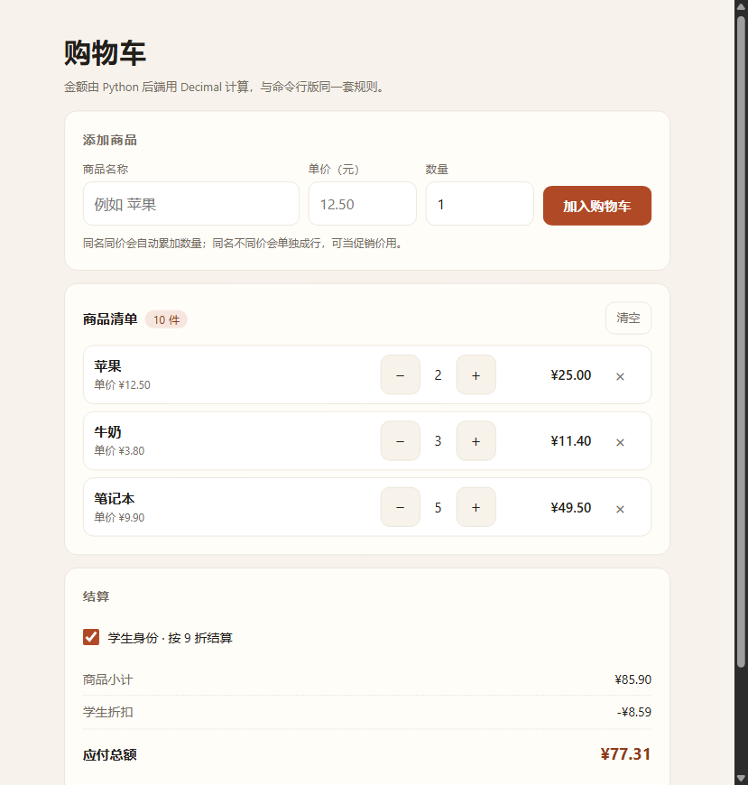
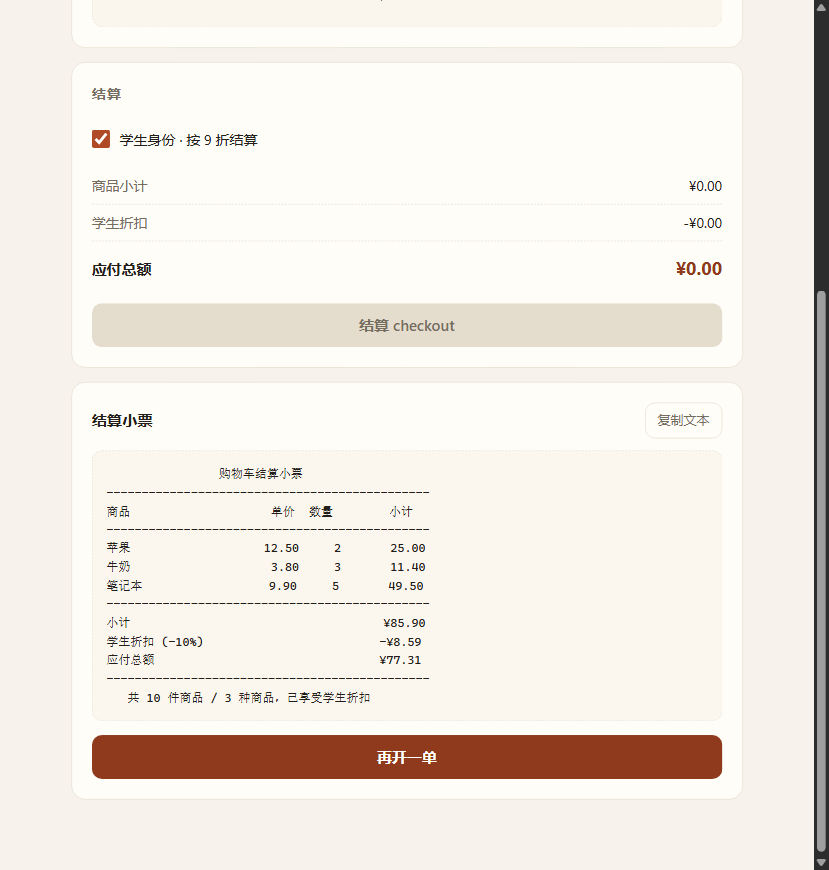

# 购物车系统（Python）

一个不依赖第三方库的 Python 购物车小项目：添加商品、记录数量与单价、计算小计与总价、
支持学生折扣、`checkout` 结算并生成小票，附完整单元测试，可直接用于课程作业 / 小组协作开发。
提供**命令行**与**网页**两种界面，共用同一套 `cart.py` 业务逻辑。

运行环境：Python 3.10+（3.9 已 EOL，CI 矩阵为 3.10–3.13）。

[](https://github.com/zmjjkk-ht/shopping-cart/actions/workflows/ci.yml)

## 功能

| 功能 | 说明 |
| --- | --- |
| 添加商品 | `add_item(name, unit_price, quantity=1)`，同名同价自动累加数量，同名不同价单独成行（可用于促销价场景） |
| 数量与单价 | 单价支持 `int` / `float` / `str` / `Decimal`，内部统一转 `Decimal`，不会有 `0.1 + 0.2 = 0.30000000000000004` 这类浮点误差 |
| 金额计算 | 行小计 = 单价 × 数量，按「四舍五入到分」；商品小计 = 各行小计之和，保证小票上每一行加得起来 |
| 学生折扣 | 默认 9 折（`student_rate=0.90`），可自定义，只在 `checkout(student=True)` 时生效 |
| checkout 结算 | 返回不可变的 `Receipt` 小票对象，含明细、小计、折扣、应付总额；默认结算后清空购物车 |
| 增删改 | `set_quantity` / `remove_item`（支持整行删除或部分减数）/ `clear` |
| 参数校验 | 空名称、负价、0 价、非整数数量、NaN/Inf、非法折扣率全部抛 `CartError` 系异常 |
| 网页版 | `webapp.py` 用标准库 `http.server` 提供 JSON API + 页面，浏览器里加减数量、切换学生身份、结算看小票 |



## 目录结构

```
shopping-cart/
├── cart.py                    # 核心逻辑：CartItem / ShoppingCart / Receipt
├── main.py                    # 命令行入口（交互菜单 + --demo 演示）
├── webapp.py                  # 网页版：标准库 http.server，JSON API + 静态页
├── web/
│   └── index.html             # 网页界面（内联 CSS/JS，移动优先）
├── tests/
│   ├── __init__.py
│   ├── test_cart.py           # 41 个单元测试：金额、折扣、校验、结算
│   └── test_webapp.py         # 16 个接口测试：真实起服务跑 HTTP 请求
├── docs/                      # README 用的界面截图
├── README.md
├── CONTRIBUTING.md            # 协作开发规范（分支 / 提交信息 / PR 流程）
├── requirements-dev.txt       # 仅开发需要（pytest 可选）
├── .gitignore
└── .github/
    ├── pull_request_template.md
    └── workflows/
        └── ci.yml             # GitHub Actions：push / PR 自动跑测试
```

## 快速开始

```bash
python main.py          # 交互式菜单
python main.py --demo   # 直接看一遍完整演示（含结算小票）
python main.py --rate 0.85   # 学生 85 折
```

菜单项：`1` 添加商品 / `2` 查看购物车 / `3` 修改数量 / `4` 删除商品 /
`5` 结算 checkout / `6` 清空 / `7` 切换学生身份 / `0` 退出。

## 网页版

```bash
python webapp.py                        # 默认 http://127.0.0.1:8000/
python webapp.py --port 8010 --rate 0.85   # 换端口 / 学生 85 折
```

浏览器打开后：填商品名 / 单价 / 数量加入购物车，清单里用 `−` `+` 调数量、点 `×` 删除，
勾选「学生身份」折扣立刻生效，点「结算 checkout」出小票（可一键复制文本）。



页面与后端的关系：

- 前端 `web/index.html`：单文件内联 CSS/JS，不引任何 CDN；移动优先（375px 起，≥600px 才切成单行布局）
- 后端 `webapp.py`：`CartService` 加线程锁，业务全部调用 `cart.py`；金额只以字符串下发，前端不做任何算术
- 数据只有一个内存购物车，重启进程即清空（要持久化见下方扩展方向）

接口：

| 方法 | 路径 | 说明 |
| --- | --- | --- |
| GET | `/api/state` | 当前清单、小计、折扣、应付 |
| POST | `/api/items` | 添加商品 `{"name","price","quantity"}` |
| PUT | `/api/items` | 改数量 `{"name","price","quantity"}`，传 0 等于删除 |
| DELETE | `/api/items` | 删除整行 `{"name","price"}` |
| POST | `/api/student` | 切换学生身份 `{"student":true}` |
| POST | `/api/clear` | 清空购物车 |
| POST | `/api/checkout` | 结算 `{"student":true,"clear":true}`，返回小票文本 + 结构化数据 |

出错统一返回 `400` 与 `{"error": "..."}`，前端用底部提示条显示原因。

## 作为模块使用

```python
from cart import ShoppingCart

cart = ShoppingCart(student_rate="0.90")   # 9 折
cart.add_item("苹果", "12.50", 2)          # 25.00
cart.add_item("牛奶", "3.80", 3)           # 11.40

print(cart.subtotal)                 # 36.40
print(cart.discount_amount(True))    # 3.64
print(cart.total(True))              # 32.76

receipt = cart.checkout(student=True)  # 结算并清空购物车
print(receipt.as_text())               # 打印小票
print(receipt.as_dict())               # 或者拿结构化数据对接前端/接口
```

结算小票示例：

```
                购物车结算小票
----------------------------------------------
商品                    单价  数量        小计
----------------------------------------------
苹果                   12.50     2       25.00
牛奶                    3.80     3       11.40
笔记本                  9.90     5       49.50
----------------------------------------------
小计                                    ¥85.90
学生折扣 (-10%)                         -¥8.59
应付总额                                ¥77.31
----------------------------------------------
   共 10 件商品 / 3 种商品，已享受学生折扣
```

## 计算规则（重点）

1. **金额类型**：所有金额走 `decimal.Decimal`，`float` 通过 `str()` 中转，避免二进制浮点误差。
2. **行小计**：`round_money(unit_price * quantity)`，`ROUND_HALF_UP` 保留 2 位。
3. **商品小计**：等于各行小计之和（不是「精确总和最后再取整」），保证小票逐行可加。
4. **学生折扣**：`discount = round_money(subtotal * (1 - student_rate))`，默认 `student_rate = 0.90`。
5. **应付总额**：`total = subtotal - discount`（两个两位小数相减，不需要再取整）。
6. 非学生或 `student_rate = 1` 时折扣为 `0.00`，逻辑统一不分支。

## 运行测试

不装任何依赖即可运行（标准库 `unittest`）：

```bash
python -m unittest discover -s tests -t . -v
```

如果本机有 pytest，也可以：

```bash
pip install -r requirements-dev.txt
python -m pytest tests -v
```

测试覆盖：金额转换与浮点误差、四舍五入边界、同名合并 / 同名不同价、非法单价与数量、
自定义折扣率、折扣取整、部分删除、`checkout` 空车异常、结算后是否清空、小票文本与字典输出；
网页版部分会真实启动一个本地服务，用 HTTP 请求验证增删改、学生折扣与结算接口。

当前共 **57 个测试**（41 个业务 + 16 个接口）。

## 后续可以怎么做（扩展方向）

- 满减 / 满折：`subtotal >= threshold` 再叠加一档优惠
- 优惠券与会员等级：把 `discount_amount` 拆成策略对象（`DiscountStrategy`）
- 商品库存与条形码：新增 `Product` 类，购物车只存 `(product_id, quantity)`
- 持久化：`json` / `sqlite3` 存购物车，支持多用户
- 持久化与多用户：按 cookie / 用户 ID 分购物车，`json` / `sqlite3` 落盘

## 协作开发

分支规范、提交信息格式和 PR 流程见 [CONTRIBUTING.md](CONTRIBUTING.md)。
